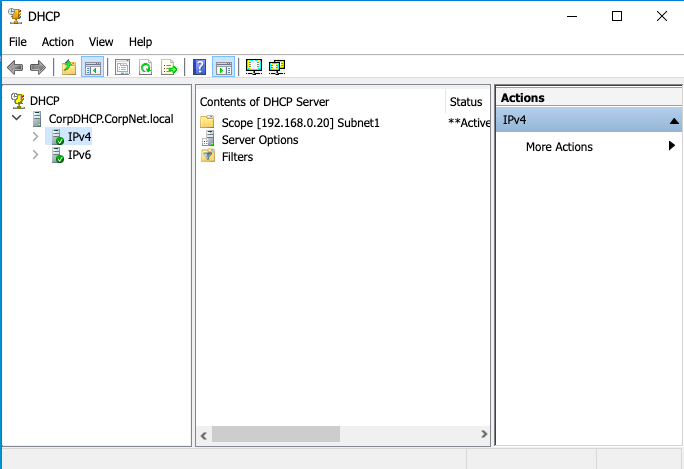
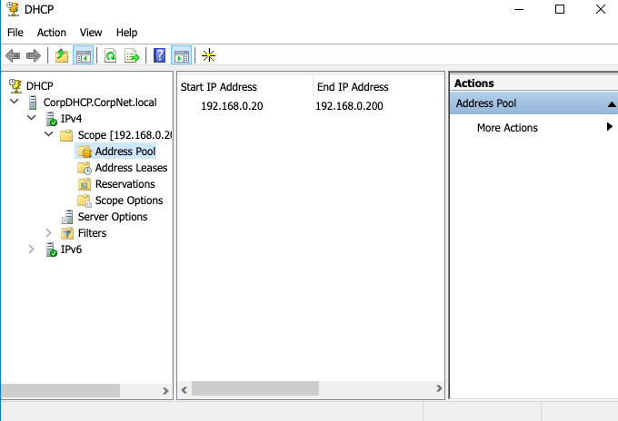
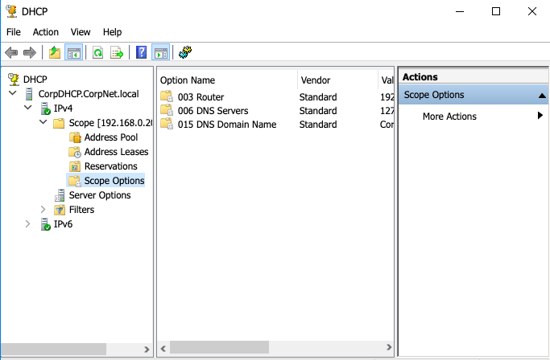
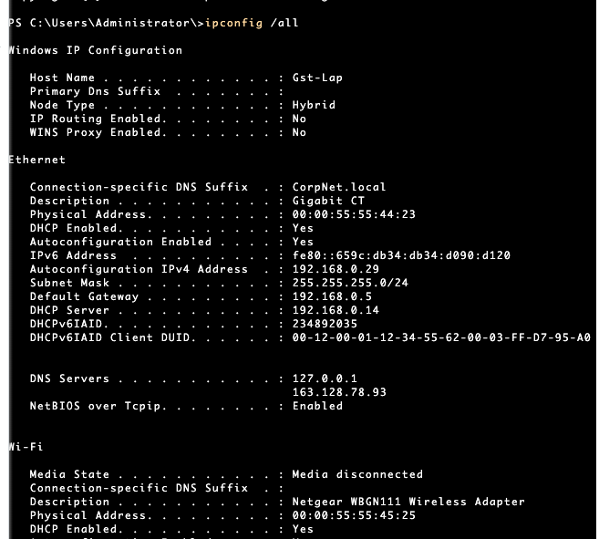
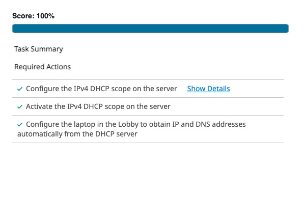

# Networking Labs (Cisco Packet Tracer)

## Overview
This project demonstrates hands-on networking experience using Cisco Packet Tracer. It includes configuring routers and switches, implementing VLANs, enabling secure remote access, and building network topologies.

---

## Labs Completed

### PS00 – Connect Network Diagram
- Connected devices based on a provided network diagram
- Verified connectivity between hosts using basic testing

---

### PS01 – Cisco IOS Show Commands
- Used Cisco IOS show commands to inspect device configurations
- Verified interface status and network information

---

### PS02 – Basic Connectivity (Switch)
- Configured switch ports for network connectivity
- Tested communication between devices using ping

---

### PS03 – Router Settings
- Configured router interfaces with IP addressing
- Verified routing between connected networks

---

### PS04 – SSH Configuration
- Enabled SSH for secure remote access to network devices
- Configured authentication and remote login settings

---

### PS05 – VLAN & Trunk
- Created VLANs and assigned switch ports
- Configured trunk links for inter-switch communication

---

### PS06 – Build Network
- Built a complete network using routers and switches
- Verified communication across multiple devices

---

### PS07 – Router-on-a-Stick
- Configured subinterfaces for inter-VLAN routing
- Enabled communication between VLANs using a router

### DHCP Server Configuration – IPv4 Addressing

- Configured and activated an IPv4 DHCP scope on a simulated Windows DHCP server.
- Created an IP address pool ranging from `192.168.0.20` to `192.168.0.200`.
- Configured DHCP scope options for the default gateway, DNS servers, and DNS domain.
- Configured a client laptop to obtain IP and DNS settings automatically.
- Verified client network configuration using `ipconfig /all`.
- Successfully completed the DHCP configuration lab with a score of **100%**.

**Tools & Technologies:** Windows DHCP Server, IPv4, DHCP, DNS, PowerShell.

#### Lab Screenshots

**DHCP Scope**

**DHCP Address Pool**

**DHCP Scope Options**

**Client IP Configuration**

**Lab Completion**

  

---

---

## Tools & Technologies

- Cisco Packet Tracer
- Cisco IOS (CLI)
- Windows DHCP Server
- PowerShell
- Routing & Switching
- VLANs & Trunking
- SSH Configuration
- DHCP & IPv4 Addressing
- DNS & Network Configuration

---

## Key Skills Gained

- Network configuration and troubleshooting
- Router and switch management
- VLAN segmentation and inter-VLAN routing
- Secure remote access (SSH)
- Network topology design
- DHCP scope configuration and activation
- Automatic IPv4 address assignment
- DHCP client configuration and verification
